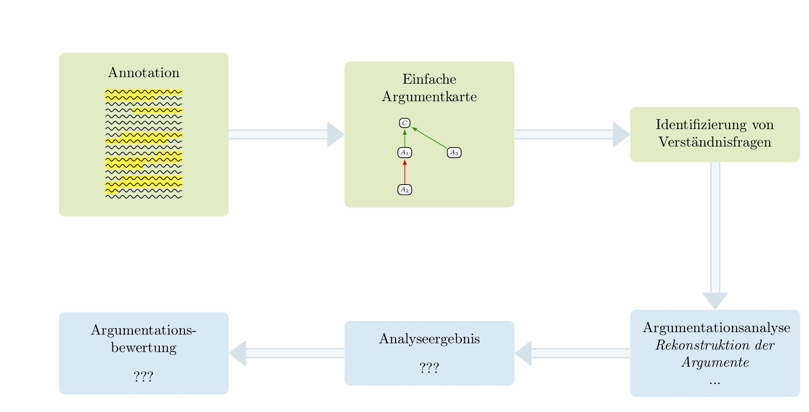

## Zusammenfassung der letzten Sitzung

::: {.callout-note}
## Die wichtigsten Punkte der letzten Sitzung:
1. **Rekonstruktion von Argumenten:** Überführung umgangssprachlich formulierter Argumente in eine Standarddarstellung so dass Prämissen, Zwischenkonklusion und die Konklusion sowie die Schlüsse explizit gemacht werden.
2. **Definition der deduktiven Gültigkeit:** Argumente sind deduktiv gültig genau dann, wenn gilt: Sind die Prämissen wahr, kann die Konklusion nicht falsch sein.
3. **Nachweis deduktiver Gültigkeit:** Die deduktive Gültigkeit eines Arguments kann man nachweisen, indem man zeigt, dass das Argument ein deduktiv gültiges Argumentschema instanziiert. 
:::

## Programm für die heutige Sitzung

1. Besprechung des Übungszettels
2. Wiederholung und Grundidee der Formalisierung
3. Aussagenlogische Formalisierung und Schlussmuster
4. Wichtige Schlussmuster mit Subjunktionen


# 1. Besprechung des Übungszettels

# 2. Wiederholung und Grundideen der Formalisierung

## Ablauf einer Argumentationsanalyse (bisheriger Stand)




## Wiederholung: Modus Ponens

```argdown
<Kontra-Argument des Theodizee Problems>: Weil es Übel gibt, existiert Gott nicht. 

(1) Wenn es Übel in der Welt gibt, dann gibt es keinen allmächtigen und 
    allgütigen Gott gibt.
(2) Es gibt Übel in der Welt.
----
(3) *Also:* Es gibt keinen allmächtigen und allgütigen Gott.
```

## Wiederholung: Modus Ponens

```argdown
<Argumentschema Modus Ponens>

(1) Wenn p, dann q.
(2) p.
-- mit Modus Ponens aus 1,2 --
(3) *Also*: q.
```

Jede Einsetzung dieses Schemas mit **Aussagesätzen** ergibt einen deduktiv gültigen Schluss. Das entsprechende Schlussmuster heißt *Modus Ponens*. 

## Grundidee: Nachweis deduktiver Gültigkeit mit Hilfe von Schlussmustern

*Ziel*: Nachweis deduktiver Gültigkeit von Argumentrekonstruktionen unter Verwendung bekannter Schlussmuster.

👉 Dafür muss sichergestellt sein, dass die in den Argumentrekonstruktionen verwendeten Sätze auch wirklich die logisch-semantische Form besitzen, die in den entsprechenden Schlussmustern benannt werden.

## Formalisierung

:::{.callout-note}
## Formalisierung
Eine Formalisierung ist die Ermittlung der logisch-semantischen Form einer Aussage oder eines Arguments, in der z.T. von deren Inhalt abstrahiert wird. Die ermittelte Form wird häufig über Buchstaben und Symbole dargestellt, um die Form explizit zu machen und um damit besser prüfen zu können, ob und welche Schlussmuster verwendet werden können.
:::

Zu einer Formalisierung gehören

1. die Angaben der **logisch-semantischen Form** mit Hilfe einer „Formel“ und
2. eine **Zuordnungsliste**, die angibt, wofür die Platzhalter in der Formel stehen. 

## Formalisierung: Ein illustratives Beispiel

> „Wenn Peter genügend Schlussmuster kennt, kann Peter prüfen, ob umgangssprachlich formulierte Argumente deduktiv gültig sind.“

Logisch-semantische Form des Satzes: Wenn-Dann-Satz der Form *„Wenn p, dann q.“*  (Subjunktion, (materiales) Konditional) 

+ Als Formel: `p → q` oder `p ⊃ q`

Verwendete Zeichen: 

+ **Kleinbuchstaben** p,q,r,...,z: stehen schematisch für **Aussagesätze** (Großbuchstaben gehen auch, werden in der Logik aber häufig für Prädikate verwendet)
+ **Symbole** `→`, `⊃`: stehen für den **Satzoperator**

## Beispiel: Das Kontra-Argument des Theodizee Problems

```argdown
<Kontra-Argument des Theodizee Problems>: Weil es Übel gibt, existiert Gott nicht. 

(1) Wenn es Übel in der Welt gibt, dann gibt es keinen allmächtigen und 
    allgütigen Gott gibt.
    // p → q
(2) Es gibt Übel in der Welt.
    // p
-- aus 1,2 mit Modus Ponens --
(3) *Also:* Es gibt keinen allmächtigen und allgütigen Gott.
    // q
```

**Zuordnungsliste:**

| Platzhalter | Steht für |
|--------|-----------|
| p      | „Es gibt Übel in der Welt.“ |
| q      | „Es gibt keinen allmächtigen und allgütigen Gott.“ |

## Erweiterte Standarddarstellung von Argumenten

**Standarddarstellung von Argumenten**: Listendarstellung der Prämissen-Konklusion-Struktur von Argumenten (explizite Kennzeichnung der Rolle von Sätzen als Prämissen, Zwischenkonklusion bzw. Konklusion).

:::{.callout-note}
Jeder Listenpunkt enthält genau einen Aussagesatz. 
:::

:::{.callout-note}
## Erweiterte Standarddarstellung von Argumenten
Die *erweiterte* Standarddarstellung von Argumenten enthält zusätzlich zur Standarddarstellung von Argumenten die folgenden Angaben:

+ die logisch-semantische Form der Sätze (sofern sie relevant für den Gültigkeitsnachweis ist),
+ die verwendeten Schlussmuster inklusive der "Buchführung", welche Sätze für welche Folgerungen verwendet werden und
+ die Zuordungsliste, die angibt, wofür die Platzhalter $p$,$q$, .... in den Formalisierungen stehen.
:::

## Erweiterte Standarddarstellung von Argumenten - Beispiel (Variante)

1. Wenn es Übel in der Welt gibt, dann gibt es keinen allmächtigen und allgütigen Gott gibt.
2. Es gibt Übel in der Welt.
3. *Also (aus 1,2 mit Modus Ponens):* Es gibt keinen allmächtigen und allgütigen Gott.

Logisch-semantische Form der Sätze:

| Satz | Satzform |
|--------|-----------|
| 1 | p|
| 2 | p → q |
| 3 | q |

Zuordnungsliste: ...

| Platzhalter | Steht für |
|--------|-----------|
| p      | „Es gibt Übel in der Welt.“ |
| q      | „Es gibt keinen allmächtigen und allgütigen Gott.“ |

## Aussagenlogische Analyse: Hinweis

:::{.callout-important}
Das, wofür die Platzhalter $p,q,..$ stehen, sollte nach Möglichkeit aus sich heraus verständlich
sein. Zeit- und Ortsadverbien wie „jetzt“, „heute“, „hier“ und „dort“ sollten möglichst durch
genaue Zeit- und Ortsangaben ersetzt werden. Personalpronomina wie „ich“, „du“, „er“
usw. sollten durch Namen ersetzt werden, sofern sie bekannt sind.
:::

Bsp.: Tamara Meyer sagt am 11.02.2022: „Ich fühle mich heute krank“.

Der von Tamara Meyer geäußerte Satz könnte so formalisiert werden: `p` mit der Einsetzung `p`: *„Tamara Meyer fühlt sich am 11.02.2022 krank.“*

## Aussagenlogische und prädikatenlogische Formalisierung

Wir unterscheiden:

1. **Aussagenlogische Analyse:** kleinste Bestandteile der Analyse sind Aussagesätze und Satzoperatoren der Aussagenlogik
	+ Bsp. Konjunktion: `p und q`
2. **Prädikatenlogische Analyse:** Hier werden Aussagesätze z.T. in ihrer internen Struktur analysiert. Kleinste Bestandteile können sein: Quantoren, Variablen, Eigennamen, Prädikate, Relationen.

## Satzoperatoren

> „Ich hoffe, dass man in dieser Übung etwas Sinnvolles lernen kann.“

## Satzoperatoren

> „Ich hoffe, dass man in dieser Übung etwas Sinnvolles lernen kann.“

+ Die interne Struktur des Satzes könnte man so verstehen:
    + innerhalb der Hoffen-Dass-Konstruktion steht ein Aussagesatz
+ Solche Konstruktionen werden Satzoperatoren genannt: Satzoperatoren kann man anwenden auf Aussagesätze, so dass sich ein neuer Aussagesatz ergibt.

:::{.callout-note}
## Aussagen
Eine Aussage ist der Sinn eines mündlich oder schriftlich geäußerten Aussagesatzes. Durch
die Äußerung eines solchen Satzes wird behauptet, dass etwas der Fall ist. Aussagen sind in
der Regel wahr oder falsch.
:::

## Beispiele für Satzoperatoren

+ Es ist nicht der Fall, dass ...
+ (Es ist der Fall, dass)... und (es ist der Fall, dass)...
+ Wenn (gilt, dass)..., dann (gilt, dass)...
+ Es ist möglich, dass ...
+ Petra ist überzeugt, dass...
+ Es ist unwahrscheinlich, dass..
+ ...


## Satzoperatoren der Aussagenlogik

| Satzoperator | Satzform (schematisch) | Aussagenlogische Formel |
|--------------|------------------------|-------------------------|
| Subjunktion/ (materiales) Konditional | `'Wenn p, dann q.'`| '$p\rightarrow q$' oder '$p\supset q$'
| Bisubjunktion (Bikonditional) | `'p genau dann, wenn q.'` |  '$p\leftrightarrow q$' oder '$p\equiv q$' |
| Disjunktion (Adjunktion) | `'p oder q.'` | '$p\vee q$' |
| Konjunktion | `'p und q.'`| '$p\wedge q$' oder '$p.q$' oder '$p\&q$'|
| Negation | `'Es ist nicht der Fall, dass p.'` | '$\neg p$' oder auch '$\sim p$'|

## Formalisierungsvariante des Kontra-Arguments

```argdown
<Kontra-Argument des Theodizee Problems>: Weil es Übel gibt, existiert Gott nicht. 

(1) Wenn es Übel in der Welt gibt, dann gibt es keinen allmächtigen und 
    allgütigen Gott gibt.
    // p → q
(2) Es gibt Übel in der Welt.
    // p
-- aus 1,2 mit Modus Ponens --
(3) *Also:* Es gibt keinen allmächtigen und allgütigen Gott.
    // q
```

🤔 Können wir das auch anders formalisieren?

## Formalisierungsvariante des Kontra-Arguments

```argdown
<Kontra-Argument des Theodizee Problems>: Weil es Übel gibt, existiert Gott nicht. 

(1) Wenn es Übel in der Welt gibt, dann gibt es keinen allmächtigen und 
    allgütigen Gott gibt.
    // p → ¬q
(2) Es gibt Übel in der Welt.
    // p
-- aus 1,2 mit Modus Ponens --
(3) *Also:* Es gibt keinen allmächtigen und allgütigen Gott.
    // ¬q
```

**Zuordnungsliste:**

| Platzhalter | Steht für |
|--------|-----------|
| p      | „Es gibt Übel in der Welt.“ |
| q      | „Es gibt einen allmächtigen und allgütigen Gott.“ |

## Aussagenlogische Analyse: Mehrdeutigkeit der Formalisierung & Adäquatheitsbedingungen der Formalisierung

::: {.callout-important}
## Mehrdeutigkeit in der Formalisierung
Es gibt häufig mehrere Möglichkeiten, einen Satz zu formalisieren. Im Kontext der Gültigkeitsprüfung geht es darum, eine **adäquate** Formalisierung zu finden, so dass gezeigt werden kann, dass das vermeintlich gültige Argument tatsächlich gültig ist.
:::

:::{.callout-warning}
# Adäquatheitsbedingungen der aussagenlogischen Formalisierung
1. Sätze haben eine aussagenlogische Form nur dann, wenn das, wofür die Platzhalter $p,q,..$ stehen, für sich **allein** genommen Aussagesätze sind.
2. Der „zurückübersetzte“ Satz sollte entweder bedeutungsgleich mit dem Ausgangssatz sein oder aus ihm folgen. Vor allem dürfen keine Bedeutungsbestandteile hinzugefügt werden, die nicht im Ausgangssatz enthalten sind!
:::

👉 Die Adäquatheitsbedingungen müssen geprüft werden durch das Anlegen einer Zuordnungsliste und einer Rückübersetzung anhand dieser Liste und der angenommenen logisch-semantischen Form.

## Adäquatheitscheck: Am Beispiel

```argdown
(1) Wenn es Übel in der Welt gibt, dann gibt es keinen allmächtigen und 
    allgütigen Gott gibt.
    // p → ¬q
(2) Es gibt Übel in der Welt.
    // p
-- aus 1,2 mit Modus Ponens --
(3) *Also:* Es gibt keinen allmächtigen und allgütigen Gott.
    // ¬q
```

**Zuordnungsliste:**

| Platzhalter | Steht für |
|--------|-----------|
| p      | „Es gibt Übel in der Welt.“ |
| q      | „Es gibt einen allmächtigen und allgütigen Gott.“ |

**Rückübersetzung:** (`¬`: *Es ist nicht der Fall, dass*)

+ `¬q`: Es ist nicht der Fall, dass es einen allmächtigen und allgütigen Gott gibt. ✅
+ `p → ¬q`: Wenn es Übel in der Welt gibt, dann ist es nicht der Fall, dass es einen allmächtigen und allgütigen Gott gibt. ✅

# 3. Aussagenlogische Formalisierung

## Subjunktion (Konditional)

Sätze der Form `„Wenn p, dann q.“` (auch: Subjunktionen) sind **Bedingungssätze**: Sie drücken notwendige und hinreichende Bedingungen aus.

+ Der Vordersatz wird Antezedenz genannt und drückt in der Subjunktion eine hinreichende Bedingung für den Nachsatz (auch Konsequenz genannt) aus:
    + *p ist hinreichend für q*: p reicht hin um mit dem Wenn-dann-Satz auf q zu schlussfolgern. (modus ponens)
+ Der Nachsatz wird Konsequenz genannt und drückt eine notwendige Bedingung für das Antezedenz aus:
    + *q ist notwendig für p*: Ist q nicht der Fall, kann man mit dem Wenn-dann-Satz auf die Negation von p schließen. 

## Beispielargument mit Nur-Konstruktion

> Nur wenn Peter Logikkurse erfolgreich besucht hat, kann er die logisch-semantische Form von Sätzen korrekt analysieren. Da er das kann, hat er wohl solche Kurse erfolgreich besucht.

Textnahe einfache Standarddarstellung:

```argdown
(1) Nur wenn Peter Logikkurse erfolgreich besucht hat, kann er
    die logisch-semantische Form von Sätzen korrekt analysieren.
    // Form: Nur wenn p, dann q.
(2) Peter kann die logisch-semantische Form von Sätzen korrekt
    analysieren.
    // q
-- aus 1,2 mit ??? --
(3) *Also:* Peter hat Logikkurse erfolgreich besucht
    // p
```

🤔 Ist die angegebene schematische Satzform auch eine Subjunktion oder etwas anderes?

## Beispielargument mit Nur-Konstruktion

> Nur wenn Peter Logikkurse erfolgreich besucht hat, kann er die logisch-semantische Form von Sätzen korrekt analysieren. Da er das kann, hat er wohl solche Kurse erfolgreich besucht.

Reformulierung der ersten Version:

```argdown
(1) Wenn Peter die logisch-semantische Form von Sätzen korrekt
    analysieren kann, hat er erfolgreich Logikkurse besucht.
    // q → p.
(2) Peter kann die logisch-semantische Form von Sätzen korrekt
    analysieren.
    // q
-- aus 1,2 mit Modus Ponens --
(3) *Also:* Peter hat Logikkurse erfolgreich besucht
    // p
```

🤔 Darf man das? 

## Subjunktionen mit "nur" Konstruktionen

:::{.callout-important}
## Achtung mit „nur“ Konstruktionen
Steht das Wort „nur“ unmittelbar vor dem Ausdruck „wenn“ oder „dann“, „dreht“ es den Sinn
des Satzes um. In Sätzen der Form *„nur wenn q, dann p“* und *„p nur dann, wenn q“* ist q
eine notwendige Bedingung. Beide Sätze sind im Sinne von „wenn p, dann q“ zu verstehen.
:::

👉 Nur-wenn-dann Sätze sind auch Subjunktionen. Es gibt viele Formulierungsvarianten. Machen Sie sich immer klar, was hinreichende und notwendige Bedingungen sind und formulieren Sie Subjunktionen in Argumentrekonstruktionen immer in der Form „Wenn p, dann q.“ aus.

## Subjunktion (Konditional): Formulierungsvarianten

Die folgenden Formulierungen drücken die gleiche logische Form aus wie Sätze der Form *„Wenn p, dann q.“*:

+ „Falls p, so auch q.“
+ „Im Fall, dass p, so q.“
+ „Sofern p, q.“
+ „Gesetzt, p , gilt q.“
+ „Nur wenn q, p.“
+ „p nur dann, wenn q.“

## Subjunktion: Beispiele

1. Henrike wird sich sehr ärgern und nach Hause gehen, wenn ihr Freund nicht bald
auftaucht.
2. Erst wenn du Freunde hast, wirst du glücklich.
3. Friedrich tanzt nur, wenn Petra oder seine Kumpel mit ihm tanzen.

## Zurück zum Beispielargument mit Nur-Konstruktion

> Nur wenn Peter Logikkurse erfolgreich besucht hat, kann er die logisch-semantische Form von Sätzen korrekt analysieren. Da er das kann, hat er wohl solche Kurse erfolgreich besucht.

Reformulierung der ersten Version:

```argdown
(1) Wenn Peter die logisch-semantische Form von Sätzen korrekt
    analysieren kann, hat er erfolgreich Logikkurse besucht.
    // q → p.
(2) Peter kann die logisch-semantische Form von Sätzen korrekt
    analysieren.
    // q
-- aus 1,2 mit Modus Ponens --
(3) *Also:* Peter hat Logikkurse erfolgreich besucht
    // p
```

🤔 Darf man das? Ja: Wir haben den Nur-Wenn-Satz umformuliert ohne seine Bedeutung zu verändern.


## Formalisierungsschleifen & adäquate Reformulierungen von Sätzen in Argumentreksontruktionen

*Herausforderung*: Die in den uns bekannten Schlussmustern auftauchenden Satzformen tauchen häufig nicht explizit formuliert in umgangssprachlichen Sätzen auf!

Wie geht man mit diesem Problem um?

## Formalisierungsschleifen & adäquate Reformulierungen von Sätzen in Argumentreksontruktionen

*Lösung*: Wir reformulieren die Ausgangssätze so um, dass sie 

(i) eine bekannte Form besitzen, jedoch immer noch 
(ii) bedeutungsgleich mit dem Ausgangssatz sind oder zumindest den für die Gültigkeit des Schlusses wesentlichen Kern besitzen. (Vor allem dürfen keine Bedeutungsbestandteile hinzugefügt werden, die nicht im Ausgangssatz enthalten sind!)

Es wird sich zeigen, dass man viele Sätze so umformulieren kann, dass die bekannten Schlussmuster angewendet werden können.

# 4. Wichtige Schlussmuster mit Subjunktionen

## Schlussmuster: Modus Ponens

```argdown
<Argumentschema Modus Ponens>

(1) Wenn p, dann q.
    // p → q
(2) p.
-- mit Modus Ponens aus 1,2 --
(3) *Also*: q.
```

## Variante des Kontra-Arguments

Eine weitere Variante unser Rekonstruktion des Kontra-Arguments (vgl. [Mitschrift der letzten Sitzung](https://argumentkartierung.github.io/hhu-philosophisches-argumentieren-ws-26-27/content/notes/sitzung-02-notes.html)):

```argdown
<Kontra-Argument des Theodizee Problems>: Weil es Übel gibt, existiert Gott nicht. 

(1) Wenn es einen allmächtigen und allgütigen Gott gibt,
    dann gibt es kein Übel in der Welt.
(2) Es ist nicht der Fall, dass es keine Übel in der Welt
    gibt.
-- aus 1,2 mit ??? --
(3) *Also:* Es gibt keinen allmächtigen und allgütigen Gott.
```

## Variante des Kontra-Arguments

```argdown
<Kontra-Argument des Theodizee Problems>: Weil es Übel gibt, existiert Gott nicht. 

(1) Wenn es einen allmächtigen und allgütigen Gott gibt,
    dann gibt es kein Übel in der Welt.
    // p → q
(2) Es ist nicht der Fall, dass es keine Übel in der Welt
    gibt.
    // ¬q
-- aus 1,2 mit Modus Tollens --
(3) *Also:* Es gibt keinen allmächtigen und allgütigen Gott.
    // ¬p
```

👉 Hier wird in der zweiten Prämisse der Nachsatz der Subjunktion verneint. (In der Rede von notwendigen und hinreichenden Bedingungen: Eine durch die erste Prämisse ausgedrückte notwendige Bedingung für die Existenz Gottes wird verletzt.)

## Schlussmuster: Modus Tollens

```argdown
<Argumentschema Modus Tollens>

(1) Wenn p, dann q.
    // p → q
(2) Es ist nicht der Fall, dass q.
    // ¬q
-- mit Modus Tollens aus 1,2 --
(3) *Also*: Es ist nicht der Fall, dass p.
    // ¬p
```

## Schlussmuster: Transitivität (Kettenregel)

```argdown
<Argumentschema Transitivität>

(1) Wenn p, dann q.
    // p → q
(2) Wenn q, dann r.
    // q → r
-- aus 1,2 mit Transitivität --
(3) *Also*: Wenn p, dann r.
    // p → r
```

Beispiel: 

```argdown
(1) Wenn Tanja Argumente rekonstruieren kann, kann Tanja 
    Sätze formalisieren.
(2) Wenn Tanja Sätze formalisieren kann, ist Tanja 
    gut in Logik.
-- aus 1,2 mit Transitivität --
(3) *Also*: Wenn Tanja Argumente rekonstruieren kann, 
    ist Tanja gut in Logik.
```

## Schlussmuster: Kontraposition

```argdown
<Argumentschema Kontraposition>

(1) Wenn p, dann q.
    // p → q
-- aus 1 mit Kontraposition--
(2) *Also*: Wenn q falsch ist, dann ist p falsch.
    // ¬q → ¬p
```

Beispiel: 

```argdown
(1) Wenn Tanja Argumente rekonstruieren kann, 
    ist Tanja gut in Logik.
-- aus 1 mit Kontraposition --
(2) *Also*: Wenn Tanja nicht gut in Logik ist, kann Tanja 
    Argumente nicht rekonstruieren.
```

# Abschluss

## Zusammenfassung

::: {.callout-note}
## Die wichtigsten Punkte der heutigen Sitzung:
1. **Rolle von Formalisierung und Schlussmuster:** Durch die Formalisierung der Sätze in Argumentrekonstruktionen wird die logisch-semantische Struktur der Aussagen bestimmt. Dadurch lässt sich erkennen, ob Konklusionen und Zwischenkonklusionen durch die Anwendung bekannter Schlussmuster deduktiv gültig aus den Prämissen folgen.
2. **Mehrdeutigkeit & Adäquatheit der Formalisierung:** Es gibt in der Regel mehrere Möglichkeiten, die Sätze einer Argumentrekonstruktion adäquat zu formalisieren. Jeder Formalisierungsvorschlag sollte über die explizite Angabe einer Zuordnungsliste und einer darauf basierenden "Rückübersetzung" auf Adäquatheit überprüft werden.
3. **Reformulierung von Prämissen:** Prämissen dürfen (und sollten) so umformuliert werden, dass ihre logisch-semantische Struktur möglichst explizit ist und die Anwendung entsprechender Schlussmuster ermöglicht wird. Die Umformulierungen müssen bedeutungsgleich
mit der Ausgangsformulierung sein oder zumindest den für die Gültigkeit des Schlusses wesentlichen Kern besitzen. (Vor allem dürfen keine Bedeutungsbestandteile hinzugefügt werden, die nicht in der Ausgangsformulierung enthalten sind!)
:::


## Ende

::: {.r-stack style="font-size: 2em; margin-top: 3em;"}
🙏 Danke!
:::
