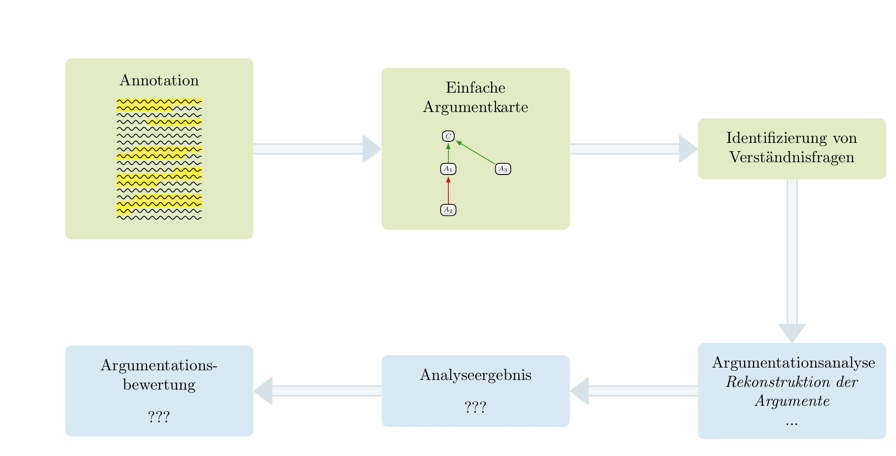

## Zusammenfassung der letzten Sitzung

::: {.callout-note}
## Die wichtigsten Punkte der letzten Sitzung:
1. **Rolle von Formalisierung und Schlussmuster:** Durch die Formalisierung der Sätze in Argumentrekonstruktionen wird die logisch-semantische Struktur der Aussagen bestimmt. Dadurch lässt sich erkennen, ob Konklusionen und Zwischenkonklusionen durch die Anwendung bekannter Schlussmuster deduktiv gültig aus den Prämissen folgen.
2. **Mehrdeutigkeit & Adäquatheit der Formalisierung:** Es gibt in der Regel mehrere Möglichkeiten, die Sätze einer Argumentrekonstruktion adäquat zu formalisieren. Jeder Formalisierungsvorschlag sollte über die explizite Angabe einer Zuordnungsliste und einer darauf basierenden "Rückübersetzung" auf Adäquatheit überprüft werden.
3. **Reformulierung von Prämissen:** Prämissen dürfen (und sollten) so umformuliert werden, dass ihre logisch-semantische Struktur möglichst explizit ist und die Anwendung entsprechender Schlussmuster ermöglicht wird. Die Umformulierungen müssen bedeutungsgleich
mit der Ausgangsformulierung sein oder zumindest den für die Gültigkeit des Schlusses wesentlichen Kern besitzen. (Vor allem dürfen keine Bedeutungsbestandteile hinzugefügt werden, die nicht in der Ausgangsformulierung enthalten sind!)
:::

## Ablauf einer Argumentationsanalyse (bisheriger Stand)




## Programm für die heutige Sitzung

1. Nachbesprechung des Übungszettels
2. Argumente kritisieren
3. Widersprüche

# 1. Nachbesprechung des Übungszettels

👉 Siehe [Mitschrift zur heutigen Sitzung](https://argumentkartierung.de/hhu-philosophisches-argumentieren-ws-26-27/content/notes/sitzung-04-notes.html)

# 2. Argumente kritisieren

## Wiederholung: Was sind Argumente?

::: {.callout-note}
## Allgemeine Beschreibung von Argumenten
Ein Argument ist eine Menge von Sätzen, derart, dass ein Teil der Sätze (die Prämissen) mit dem **Anspruch** formuliert werden, einen anderen Teil zu begründen (die Konklusion).
:::

**Standardform**: Prämissen-Konklusion-Struktur

```argdown
(1) Erste Prämisse...
(2) Zweite Prämisse...
(3) ...
----
(4) *Also*: Konklusion
```

## Argumentevaluierung

Grundidee der Evaluation einzelner Argumente: Es gibt 3 Möglichkeiten Argumente zu kritisieren:

1. Mit dem Begründungsteil stimmt was nicht (falsche/unplausible Prämissen).
2. Mit der Konklusion stimmt was nicht (falsche/unplausible Konklusion).
3. Mit der Begründungsbeziehung stimmt was nicht. 

Liefert uns die Begründungsbeziehung der deduktiven Gültigkeit angewendet auf ein **vorgebrachtes, umgangssprachlich formuliertes Argument** schon ein einfaches Evaluationskriterium?

## Argumentevaluierung: Die Begründungsbeziehung - Idee 1

Liefert uns die Begründungsbeziehung der deduktiven Gültigkeit schon ein einfaches Evaluationskriterium? Bspw.:

::: {.callout-note}
## Evaluationskriterium - Idee 1
Folgt bei einem vorgebrachten Argument das zu Begründende **nicht deduktiv gültig** aus der explizit genannten Begründung stimmt mit dem Argument etwas nicht.
:::

## Argumentevaluierung: Die Begründungsbeziehung - Idee 2

::: {.callout-note}
## Evaluationskriterium - Idee 2
Folgt bei einem vorgebrachten Argument das zu Begründende **weder deduktiv gültig noch induktiv** aus der explizit genannten Begründung stimmt mit dem Argument etwas nicht.
:::

## Argumentevaluierung: Die Begründungsbeziehung - Idee 2

Illustratives Beispiel:

> Durch die Herstellung von Pornofilmen werden die Darstellenden erniedrigt, da sie dadurch als Instrumente zur Befriedigung sexueller Wünsche anderer Menschen missbraucht werden. 

Rekonstruktion:

```argdown
(1) Durch die Herstellung von Pornofilmen werden die Darstellenden als Instrumente zur Befriedigung sexueller Wünsche anderer Menschen missbraucht.
-- begründet durch 1 --
(2) *Also:* Durch die Herstellung von Pornofilmen werden die Darstellenden erniedrigt.
```

🤔 Wie steht es denn hier um die Begründungsbeziehung? Ist das Argument deduktiv gültig oder zumindest induktiv stark?

## Argumentevaluierung: Die Begründungsbeziehung - Idee 2

> Durch die Herstellung von Pornofilmen werden die Darstellenden erniedrigt, da sie dadurch als Instrumente zur Befriedigung sexueller Wünsche anderer Menschen missbraucht werden. 

```argdown
(1) Durch die Herstellung von Pornofilmen werden die Darstellenden als Instrumente zur Befriedigung sexueller Wünsche anderer Menschen missbraucht.
-- begründet durch 1 --
(2) *Also:* Durch die Herstellung von Pornofilmen werden die Darstellenden erniedrigt.
```

👉 Die meisten Argumente, die uns in Texten oder Gesprächen begegnen, sind weder deduktiv gültig noch induktiv stark bzgl. der explizit genannten Begründungsbestandteile. I.S.v: Das zu Begründende folgt weder ded. gültig noch induktiv allein aus dem **explizit** Genannten.

🤔 Sind diese Argumente allein deswegen defizitär?

## Argumentevaluierung: Die Begründungsbeziehung & Implizite Prämissen

Naheliegender ist vlt., dass nicht immer alle Begründungsbestandteile explizit genannt werden.

+ Die **Rekonstruktion von Argumenten** ist ein Prozess bei dem ein im Text (oder Gespräch) identifiziertes Argument in eine (möglichst) deduktive gültige Standardform (Prämissen-Konklusion-Struktur) überführt wird. Dabei werden in der Regel:
	+ implizite Prämissen ergänzt
	+ explizit genannte Prämissen umformuliert.

Am Beispiel:

```argdown
(1) Durch die Herstellung von Pornofilmen werden die Darstellenden als Instrumente zur Befriedigung sexueller Wünsche anderer Menschen missbraucht.
(2) Wenn durch die Herstellung von Pornofilmen die Darstellenden als Instrumente zur Befriedigung sexueller Wünsche anderer Menschen missbraucht werden, dann werden durch die Herstellung von Pornofilmen die Darstellenden erniedrigt. (*implizite Prämisse*)
-- folgt (deduktiv gültig) aus 1 & 2 mit Modus Ponens --
(3) *Also:* Durch die Herstellung von Pornofilmen werden die Darstellenden erniedrigt.
```

## Argumentevaluierung: Die Begründungsbeziehung & Implizite Prämissen

Naheliegender ist vlt., dass nicht immer alle Begründungsbestandteile explizit genannt werden.

+ Die **Rekonstruktion von Argumenten** ist ein Prozess bei dem ein im Text (oder Gespräch) identifiziertes Argument in eine (möglichst) deduktive gültige Standardform (Prämissen-Konklusion-Struktur) überführt wird. Dabei werden in der Regel:
	+ implizite Prämissen ergänzt
	+ explizit genannte Prämissen umformuliert.
+ Das **ursprüngliche Argument** wird dann anhand der **Rekonstruktion des Arguments** evaluiert. 
	+ Das ursprüngliche Argument wird als deduktiv gültig bezeichnet, wenn es sich adäquat als deduktiv gültig rekonstruieren lässt. 


<!--
## Argumentrekonstruktion und Evaluierung - Idee 3

```argdown
(1) Durch die Herstellung von Pornofilmen werden die Darstellenden als Instrumente zur Befriedigung sexueller Wünsche anderer Menschen missbraucht.
(2) Wenn durch die Herstellung von Pornofilmen die Darstellenden als Instrumente zur Befriedigung sexueller Wünsche anderer Menschen missbraucht werden, dann werden durch die Herstellung von Pornofilmen die Darstellenden erniedrigt.
-- folgt (deduktiv gültig) aus 1 & 2 mit Modus Ponens --
(3) *Also:* Durch die Herstellung von Pornofilmen werden die Darstellenden erniedrigt.
```

::: {.callout-note}
## Evaluationskriterium - Idee 3
Lässt sich ein vorgebrachtes Argument weder als deduktiv gültiges noch induktiv starkes Argument adäquat rekonstruieren, stimmt mit dem vorgebrachten Argument etwas nicht.
:::
-->

## Argumentrekonstruktion und Evaluierung - Praktisch 

::: {.callout-important}
In der Regel können Argumente so rekonstruiert werden, dass sie deduktiv gültig (oder induktiv stark) sind. Kritik (an einem Argument) wird damit i.d.R. darauf hinauslaufen, die Prämissen oder die Konklusion zu kritisieren.
:::

Anders ausgedrückt: Schwächen in der Begründungsbeziehung laufen darauf hinaus, unplausible Prämissen ergänzen zu müssen, damit das Argument deduktiv gültig (bzw. induktiv stark) wird.

👉 Die Argumentrekonstruktion macht damit Schwächen in Form unplausibler Prämissen explizit!

## 4 Elemente des Philosophierens

1. **Standpunkt:** Formulierung eines Standpunktes als zu begründende Aussage.
2. **Begründung:** Begründung des Standpunktes (als Prämissen in einem Argument mit der zu begründenden Aussage als Konklusion).
3. **Einwand:** Kritik am Argument (entweder an den Prämissen oder der Konklusion).
4. **Entkräftung:** Kritik am Einwand. 


## 4 Elemente des Philosophierens

```argdown-map
===
webComponent:
  withoutHeader: true
  views:
    source: false
    map: true
dot:
  graphVizSettings:
    rankdir: TB # arrows flow from top to bottom (to produce a tree-like structure)
===

[Standpunkt]: K #pro
  <+ <Begründung>: A #pro
    <- <Einwand (Version: Kritik an einer Prämisse von A)>: E #con
      <- <Entkräftung (Version: Kritik an einer Prämisse von E)>: E\* #pro 
    <+ <Entkräftung (Version: Kritik an der Konklusion von E)>: E\* #pro
  <- <Einwand (Version: Kritik an der Konklusion von A)>: E #con
```

## Einwände und Entkräftungen als Argumente

1. **Standpunkt:** Formulierung eines Standpunktes als zu begründende Aussage.
2. **Begründung:** Begründung des Standpunktes (als Prämissen in einem Argument `A` mit der zu begründenden Aussage als Konklusion).
3. **Einwand `E`:** Kritik am Argument (entweder an den Prämissen oder der Konklusion).
    + Argument `E` mit einer Konklusion, die einer Prämisse `P` von `A` widerspricht. 
    + Argument `E` mit einer Konklusion, die der Konklusion `K` von `A` widerspricht.
4. **Entkräftung `E*`:** Kritik am Einwand (auch: Gegeneinwand oder Verteidigung). 
    + Argument `E*` mit einer Konklusion, die einer Prämisse `P*` von `E` widerspricht. 
    + Argument `E*` mit einer Konklusion, die der Konklusion `K*` von `E` widerspricht.

## Besprechung unserer bisherigen einfachen Argumentkarten

🤔 Was heißt das für unsere bisherigen Argumentkarten?

👉 Siehe [Mitschrift zur heutigen Sitzung](https://argumentkartierung.de/hhu-philosophisches-argumentieren-ws-26-27/content/notes/sitzung-04-notes.html).

# 3. Widersprüche

## Widersprüchliche Sätze

::: {.callout-note}
## Widersprüchliche Sätze
Zwei Sätze stehen im Widerspruch zueinander, wenn sie nicht beide zugleich wahr sein können.
:::

*Alternative Formulierungen*: 

+ Zwei Sätze stehen im Widerspruch zueinander, wenn aus der Wahrheit des einen die Falschheit des anderen (deduktiv gültig) folgt.
+ Zwei Sätze stehen im Widerspruch zueinander, wenn sie sich gegenseitig ausschließen.

## Widersprüchliche Sätze

::: {.callout-note}
## Widersprüchliche Sätze (Verallgemeinerung)
Sätze stehen im Widerspruch zueinander, wenn sie nicht alle zugleich wahr sein können.
:::

## Widersprüchliche Sätze: Einfaches Beispiel

Beispiel:

1. *"Es regnet gerade."*
2. *"Es ist nicht Fall, dass es gerade regnet"*

+ Einfachster Fall: Ein Satz *'p'* steht im Widerspruch zu seiner Negation *'Es ist nicht der Fall, dass p.'*.
+ Hier gilt nicht nur, dass sie nicht zugleich wahr sein können, sondern auch, dass sie nicht zugleich falsch sein können.

## Kontradiktorische Widersprüche

Beispiel:

1. *"Es regnet gerade."*
2. *"Es ist nicht Fall, dass es gerade regnet"*


::: {.callout-note}
## Kontradiktorischer Widerspruch
Zwei Sätze stehen in einem kontradiktorischen Widerspruch zueinander, wenn sie weder zugleich wahr noch zugleich falsch sein können. 
:::

## Widersprüchliche Sätze: Weiteres Beispiel

Beispiel:

1. *"Der Apfel ist vollständig rot."*
2. *"Der Apfel ist vollständig grün."*

Stehen diese beiden Sätze in einem kontradiktorischen Widerspruch zueinander?

+ Können beide zugleich wahr sein?
+ Können beide zugleich falsch sein?

## Konträre Widersprüche

Beispiel:

1. *"Der Apfel ist vollständig rot."*
2. *"Der Apfel ist vollständig grün."*

::: {.callout-note}
## Konträrer Widerspruch
Zwei Sätze stehen in einem konträren Widerspruch zueinander, wenn sie nicht zugleich wahr jedoch zugleich falsch sein können. 
:::

<!--
Das machen wir erst wenn wir die vertieften Argumentkarten behandeln.

## Rekonstruktion von konträren Widersprüchen als Argumente

```argdown
(1) Der Apfel ist vollständig rot.
(2) Gegenstände, die vollständig rot sind,
	  sind nicht vollständig grün.
-- folgt deduktiv gültig aus 1,2 --
(3) Also: Der Apfel ist nicht vollständig grün.
```
-->

# Abschluss

## Zusammenfassung

::: {.callout-note}
## Die wichtigsten Punkte der heutigen Sitzung:
1. **Implizite Prämissen & Rekonstruktion von Argumenten:** Argumente sollen als gültige Argumente rekonstruiert werden (nach Möglichkeit deduktiv gültig, andernfalls induktiv stark). Dafür müssen häufig implizite Prämissen ergänzt und vorgefundene Sätze umformuliert werden.
2. **Systematische Evaluation von einzelnen Argumenten:** Argumente werden anhand ihrer Rekonstruktion bewertet. Kritik wird damit i.d.R. darauf hinauslaufen, die Prämissen oder die Konklusion zu kritisieren.
3. **Widersprüche:** Aussagen stehen in einem Widerspruch zueinander, wenn sie nicht zugleich wahr sein können. Dabei wird zwischen kontradiktorischen und konträren Widersprüchen unterschieden.
:::


## Ende

::: {.r-stack style="font-size: 2em; margin-top: 3em;"}
🙏 Danke!
:::
