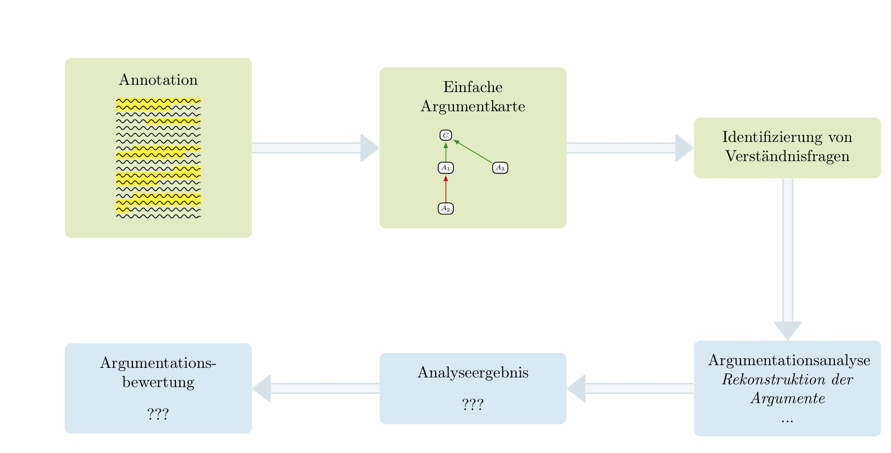
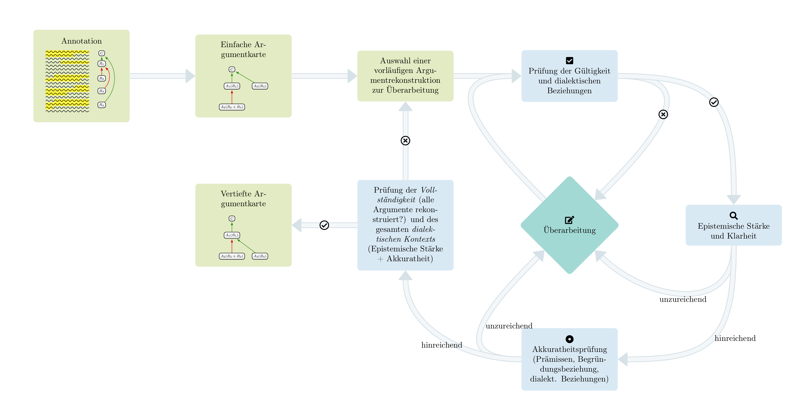

## Programm für die heutige Sitzung

1. Rekonstruktionsprinzipien
2. Besprechung & Analyse des Rütsche Textes 
3. Neue Satzformen und Schlussmuster

# 1. Rekonstruktionsprinzipien

## Argumentrekonstruktion als hermeneutische Methode

Bei der Rekonstruktion eines Arguments werden in der Regel:

+ implizite Prämissen/Konklusionen ergänzt und 
+ explizit genannte Sätze umformuliert.

Die Rekonstruktion eines Arguments oder einer komplexen Argumentation ist eine **Interpretation**, sie ist in aller Regel

+ unterbestimmt,
+ vorläufig,
+ unvollständig,
+ und besitzt Alternativen.

## Leitprinzipien der Argumentrekonstruktion

1. **Prinzip der Klarheit**: Die Sätze in der Rekonstruktion sollten möglichst explizit, präzise und klar sein. 
2. **Prinzip der Akkuratheit (Textnähe)**: Die Rekonstruktion sollte möglichst dem ursprünglichen Argument entsprechen.
3. **Prinzip der epistemischen Stärke**: Die Rekonstruktion sollte das Argument möglichst stark und plausibel machen.

## Leitprinzipien der Argumentrekonstruktion: Klarheit

Die Sätze in der Rekonstruktion sollten möglichst explizit, präzise und klar sein.

+ **Mehrdeutigkeiten/Äquivokationen vermeiden** (bspw. Art der Normativität)
	+ Jedes Vorkommnis eines Wortes innerhalb der Rekonstruktion sollte die gleiche Bedeutung besitzen.
+ **Schlagwortthesen ausformulieren:** (Kommunismus, Pazifismus, Kapitalismus, Genderwahnsinn, Leitkultur, ...)
	+ Genau welche These wird mit dem Ismus gemeint? 
+ **Bestimmte Artikel & vage Formulierungen näher bestimmen:** Was genau wird gemeint?
	+ Bsp. *"Die gesellschaftlichen Rahmenbedingungen müssen verändert werden"* Welche? Alle? Einige?
+ **Indexikalische Ausdrücke näher bestimmen:** Was genau wird mit "diese", "dort", "jetzt" gemeint?

## Leitprinzipien der Argumentrekonstruktion: Klarheit

Die Rekonstruktion sollte den argumentativen Kern des Arguments darstellen. D.h., oft können Sie die folgenden Bestandteile meist weglassen:

+ Schilderungen philosophischer Probleme und Fragen
+ rhetorische Phrasen (z. B.: „Es ist nun offensichtlich, …“, „Wie jeder erkennt, ….“)
+ Wiederholungen und Reformulierungen der Prämissen oder der Konklusion
+ Begriffsklärungen und Definitionen
+ Beispiele zur Erläuterung der Prämissen oder Konklusion

## Leitprinzipien der Argumentrekonstruktion: Epistemische Stärke

Die Rekonstruktion sollte das Argument möglichst stark und plausibel machen. 

Wollen wir bspw. ein bestimmtes von einer Person vertretenes Argument anhand einer Rekonstruktion evaluieren, sollte das Argument nicht allein aufgrund einer ungünstigen Interpretation schlecht abschneiden. D.h.:

+ **Plausibilität von Aussagen:** 
  + Ergänzte implizite Prämissen bzw. Konklusionen sollten möglichst plausibel sein.
  + Umformulierte Sätze sollten möglichst nicht unplausibler sein als die ursprünglichen Sätze. 
+ **Gültigkeit der Rekonstruktion:** Das Argument sollte möglichst deduktiv gültig sein.
+ **Irrelevante Prämissen vermeiden:** Es sollten möglichst keine für die Gültigkeit des Arguments unnötigen Prämissen ergänzt werden.^[Welche Aussnahmen gibt es hier?]

::: {.callout-note}
Irrelevant meint hier: unnötig für die Gültigkeit des Arguments im Lichte der anderen Prämissen. D.h. eine Prämisse ist in diesem Sinne genau dann irrelevant, wenn die Konklusion aus den anderen Prämissen der Standarddarstellung bereits folgt.
:::

## Leitprinzipien der Argumentrekonstruktion: Akkuratheit (Textnähe)

Die Rekonstruktion sollte möglichst dem ursprünglichen Argument entsprechen: Wollen wir bspw. ein bestimmtes von einer Person vertretenes Argument anhand einer Rekonstruktion verstehen und evaluieren, sollte es sich nach der Rekonstruktion immer noch um das Argument dieser Person handeln. D.h.:

+ Umformulierungen von Sätzen sollte nicht zu Sätzen führen, die eine andere Bedeutung haben.
+ Im Text identifizierte Begründungsansprüche sollten möglichst als solche in der Rekonstruktion wiederzufinden sein.
+ Implizite Prämissen sollten dieser Person auch unterstellt werden können bzw. dem gemeinten Sinn des Arguments entsprechen.

## Abwägung: Epistemische Stärke vs. Akkuratheit vs. Klarheit

Der genannten Prinzipien sind **gegenläufige Prinzipien**, d.h. sie können im konkreten Einzelfall im Widerstreit zueinander und müssen dann gegeneinander abgewogen werden.

## Ablauf einer Argumentationsanalyse (bisheriger Stand)



## Hermeneutische Schleife: Der Rekonstruktionsprozess



## Gegenüberstellung einfacher und vertiefter Argumentkarten

Einfache und vertiefte Argumentkarten sehen gleich aus!

**Einfache Argumentkarten:**

+ Visualisieren ihr vortheoretisches und voranalytisches Verständnis der Argumentationsstruktur eines Textes/einer Diskussion -- also Ihr Verständnis darüber, welche Argumente und Thesen es gibt und wie sich diese Elemente argumentativ aufeinander beziehen.
+ Die Stützungs- and Angriffsbeziehungen haben hier keine präzise Bedeutung.

## Gegenüberstellung einfacher und vertiefter Argumentkarten

**Vertiefte Argumentkarten:**

+ In vertieften Argumentkarten sind alle Argumente in ihrer Prämissen-Konklusion-Struktur rekonstruiert. 
+ Die Argumentbeziehungen sind präzise definiert und basieren auf semantischen Relationen zwischen den Sätzen von Argumenten.
    + Entsprechend kann man der Karte präsize Informationen ablesen. 
+ Sie haben einen gewissen Spielraum bei der Entscheidung genau welche Informationen in der Karte kodiert werden (übe die Entscheidung darüber, welche Sätze als Aussagekasten visualisiert werden und ob komplexe Argumente mit ZK-en in Teilargumente zerlegt werden).
    + Die Übungsaufgaben zum Argumentkartelesen enthalten Beispiele dafür, wie man diesen Spielraum nutzen kann.

# 2. Besprechung des Rütsche Textes

👉 Siehe [Mitschrift zur heutigen Sitzung](https://argumentkartierung.de/hhu-philosophisches-argumentieren-ws-26-27/content/notes/sitzung-07-notes.html).

# 3. Neue Satzformen und Schlussmuster

## Konjunktion

In Konjunktionen (Form `p und q`) werden zwei Aussagen durch den Satzoperator „und“ verbunden. Typischeweise werden in Konjunktionen 

1. zwei Gegenständen, Ereignissen oder den Mitgliedern zweier Gruppen eine Eigenschaft, Tätigkeit oder Beziehung zugesprochen wird,
2. einem Gegenstand, Ereignis oder den Mitgliedern einer Gruppe zwei Eigenschaften,Tätigkeiten oder Beziehungen zugesprochen werden.

## Konjunktion: Beispiele für (1)

+ Ute und Hans sind nett.
+ Der Erste Weltkrieg und der Zweite Weltkrieg gingen von Europa aus.
+ Die Deutschen und Franzosen sind Europäer.
+ Ute und Hans sind in Bernadette verliebt.
+ Brandenburg und Thüringen grenzen an Sachsen.
+ Die meisten Italiener und Franzosen glauben an Gott.

## Konjunktion: Beispiele für (2)

+ Ute ist nett und lieb.
+ Der Zweite Weltkrieg dauerte sechs Jahre und kostete etwa 55 Millionen Menschenleben.
+ Hans geht spazieren und genießt das warme Wetter.
+ Angela liebt Fred und Bert.

## Konjunktion: Mehrdeutigkeiten

Manche Sätze sind für sich genommen mehrdeutig. So lassen sich aus dem Satz „Pia und Andrea heiraten im Mai“ zwei unterschiedliche Aussagen herauslesen:

1. Pia heiratet im Mai und Andrea heiratet im Mai. (Konjunktion)
2. Pia und Andrea heiraten im Mai miteinander. (keine Konjunktion, sondern eine Aussage mit einem zusammengesetzten Subjekt)

## Konjunktion: Formulierungsvarianten

+ Weitere logische Ausdrücke mit der Funktion, Sachverhalte konjunktiv aneinanderzureihen: sowie, sowohl – als auch, zudem, ferner, zum einen – zum anderen, einerseits – andererseits, während, außerdem, ebenfalls
    + Ute sowie Hans sind nett.
    + Sowohl der Erste Weltkrieg als auch der Zweite Weltkrieg gingen von Europa aus.
+ Mit der Konjunktion werden auch viele Bindewörter formalisiert, die einen Gegensatz zweier Sachverhalte andeuten: aber, jedoch, trotzdem, dennoch, obwohl, obgleich, obschon, obzwar, wenngleich, wiewohl, nichtsdestoweniger
    + Der Gast war schon sehr betrunken, trotzdem gab ihm der Wirt alkoholische Getränke.
    + Olaf kommt zur Hochzeit von Ahmed und Hans, obwohl er ziemlich eifersüchtig ist.

## Konjunktion: Formulierungsvarianten

+ Auch *explikative Relativsätze* werden mit der Konjunktion formalisiert. Diese Nebensätze enthalten eine zusätzliche Information über einen namentlich genannten Gegenstand:
    + Kain erschlug seinen Bruder Abel, den er hasste.
+ *Restriktive Relativsätze* spezifizieren ein namentlich nicht genanntes Satzglied des Hauptsatzes; die Information des restriktiven Relativsatzes ist für das Verständnis des Hauptsatzes erforderlich. Haupt- und Nebensatz drücken gemeinsam nur eine Einzelaussage aus:
    + Die USA suchten lange nach dem Mann, der die Anschläge auf das World Trade Center geplant hatte.
    + Die Firma, für die Herbert arbeitet, bezahlt schlecht.

## Schlussmuster: Konjunktionseinführung

```argdown
<Argumentschema Konjunktionseinführung>

(1) p.
(2) q.
-- mit Konjunktionseinführung aus 1,2 --
(3) *Also*: p und q.
```

## Schlussmuster: Konjunktionsbeseitigung

```argdown
<Argumentschema Konjunktionsbeseitigung>

(1) p und q.
-- mit Konjunktionsbeseitigung aus 1 --
(3) *Also*: p.
```

## Disjunktion

In Disjunktionen (Form `p oder q`) werden zwei Aussagen durch den Satzoperator „oder“ verbunden. Teilweise steht der logische Ausdruck „oder“ 

1. zwischen den Bezeichnungen zweier Gegenstände, Ereignisse oder Gruppen, teilweise 
2. zwischen den Bezeichnungen zweier Eigenschaften, Tätigkeiten oder Beziehungen. 

Beispiele für (1):

+ Ute oder Hans ist nett.
+ Der Erste Weltkrieg oder der Zweite Weltkrieg ging von Europa aus.
+ Ute oder Hans ist in Bernadette verliebt.

Beispiele für (2):

+ Ute ist nett oder lieb.
+ Der Zweite Weltkrieg dauerte sechs Jahre oder kostete etwa 55 Millionen Menschenleben.
+ Hans geht spazieren oder genießt das warme Wetter.

## Disjunktion: Formulierungsvarianten

Im Deutschen gibt es nur wenige Alternativen zum Wort „oder“: beziehungsweise, sonst, andernfalls, alternativ

Beispiele:

+ Brandenburg beziehungsweise Thüringen grenzt an Sachsen.
+ Olaf gibt mir das Geld, sonst wird er was erleben.
+ Judith reist am Donnerstag an, andernfalls kommt sie am Freitag Vormittag.

## Ein- und ausschließendes „oder“

:::{.callout-note}
## Einschließendes „oder“ (Adjunktion)
Drückt aus, dass von zwei oder mehreren Möglichkeiten mindestens eine als Tatsache zutrifft (auch beide oder alle Möglichkeiten können als Tatsache zutreffen).
:::

:::{.callout-note}
## Ausschließendes „oder“ (Kontravalenz)
Drückt aus, dass von zwei oder mehreren Möglichkeiten jeweils nur eine als Tatsache zutrifft.
:::

Die Kontravalenz wird im Deutschen durch „entweder – oder“ ausgedrückt und kann als komplexe Aussagen formalisiert werden: $(p\vee q)\wedge\neg(p\wedge q)$ ( $p$ oder $q$ aber nicht beides zugleich)

## Schlussmuster: Disjunktionseinführung

```argdown
<Argumentschema Disjunktionseinführung>

(1) p.
-- mit Disjunktionseinführung aus 1,2 --
(3) *Also*: p oder q.
```

## Schlussmuster: Disjunktiver Syllogismus / Adjunktiver Syllogismus

```argdown
<Argumentschema Disjunktiver Syllogismus>

(1) p oder q.
(2) nicht p.
-- aus 1,2 mit disj. Syll. --
(3) *Also*: q.
```

## Schlussmuster: Kontravalenz

```argdown
<Argumentschema Kontravalenz>

(1) Entweder p oder q.
(2) p.
-- aus 1,2 mit Kontravalenz--
(3) *Also*: q ist falsch.
```

## Klammerung von Satzoperatoren

In komplexen Sätzen mit mehreren Satzoperatoren müssen z.T. Klammern gesetzt werden, um Mehrdeutigkeiten zu vermeiden. Häufig geben die Kommata einen Hinweis darauf, wo die Klammern zu setzen sind:

1. Der Attentäter würgt oder bedroht seine Opfer, und er raubt sie aus. 
    + Logisch-semantische Form: $(p\vee q)\& r$
2. Der Attentäter würgt seine Opfer, oder er bedroht sie und raubt sie aus. 
    + Logisch-semantischen Form: $p\vee (q\& r)$


## Ende

::: {.r-stack style="font-size: 2em; margin-top: 3em;"}
🙏 Danke!
:::
